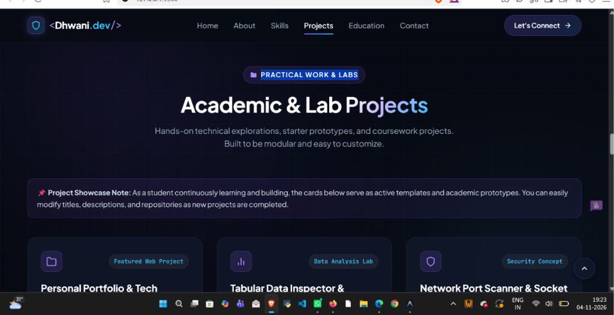

# Dhwani Jadav — Personal Portfolio & Web Technology Project

[](https://developer.mozilla.org/en-US/docs/Web/HTML)
[](https://developer.mozilla.org/en-US/docs/Web/CSS)
[](https://developer.mozilla.org/en-US/docs/Web/JavaScript)
[](LICENSE)

A modern, responsive, and visually impressive personal portfolio website built from scratch using pure **HTML5**, **CSS3**, and **Vanilla JavaScript**. Engineered for the **Web Technology Internal Assessment** by **Dhwani Jadav**, a Computer Science and Engineering student at **JG University, Ahmedabad**.

---

## 📸 Website Preview



> *Live capture of the portfolio's Projects & Practical Works section running in the browser.*

---

## 🛠️ Project Overview

This website serves as both an authentic personal developer portfolio and a comprehensive demonstration of core front-end web technologies. It showcases an ambitious, futuristic cyber aesthetic with a dark navy background, vibrant purple/blue accents, subtle glassmorphism, responsive layouts, and interactive JavaScript features.

### Student Details
- **Student Name:** Dhwani Jadav
- **Current Degree:** B.Tech in Computer Science and Engineering (Pursuing)
- **Institution:** JG University, Ahmedabad
- **Prior Qualification:** Diploma in Information and Communication Technology (ICT), Government Polytechnic for Girls, Ahmedabad
- **Career Interests:** Cybersecurity, Cloud Security, Artificial Intelligence, and Web Development


---

## 🛠️ Technologies Used

- **HTML5:** Semantic architecture, accessible attributes (`aria-*`), SVG vector graphics, meta tags for responsive viewport.
- **CSS3:** Custom properties (CSS variables), Flexbox, CSS Grid, glassmorphism (`backdrop-filter`), glowing box-shadows, keyframe animations, and `@media` queries for responsiveness.
- **Vanilla JavaScript (ES6+):** Pure DOM manipulation, event listeners (`click`, `scroll`, `input`, `submit`, `mousemove`, `resize`), Canvas 2D API for particle animations, and `localStorage` API.

---

## ✨ Key Features

1. **Futuristic Theme & Visual Identity:** Custom cyber-inspired color palette (dark navy `#070a13`, violet `#8b5cf6`, cyan `#38bdf8`) with glowing gradients and ambient background lighting.
2. **Interactive 2D Canvas Background:** Lightweight, high-performance particle constellation with gentle cursor attraction on the hero section.
3. **Sticky Glassmorphic Navigation:** Fixed navigation bar that changes background blur on scroll, with smooth scrolling offset and ScrollSpy active-link detection.
4. **Mobile-Responsive Hamburger Menu:** Collapsible mobile navigation drawer accessible on smaller screens.
5. **Authentic Biography & Timeline:** Outlines academic milestones from ICT Diploma at Government Polytechnic for Girls to B.Tech CSE at JG University.
6. **Technical Skills Grid:** Non-exaggerated, category-based skills (Python, JavaScript, HTML5, CSS3, Bootstrap, NumPy, Pandas, Cybersecurity, Cloud Security, AI) with zero fake percentage meters.
7. **Two Genuinely Working Frontend Practice Projects:**
   - **TaskMate App (To-Do List):** Add tasks, priority tagging, mark completed, delete, dynamic category filters, item counters, and `localStorage` persistence.
   - **Interactive Web Calculator:** Full standard arithmetic operations (`+`, `−`, `×`, `÷`, `%`, `±`), decimal handling, error handling, keyboard accessibility, and cyber UI.
8. **Client-Side Form Validation:** Real-time feedback and validation rules for Name, Email format (regex), Subject, and Message length with an honest demo confirmation banner.
9. **Back-to-Top Floating Button:** Smoothly scrolls users back to the top of the page when scrolled past the hero section.
10. **Dynamic Copyright Year:** Automatically fetches and renders the current year.

---

## 📂 Project Structure

```text
Web tech project portfolio/
├── assets/
│   └── screenshot.png          # High-resolution website screenshot for documentation
├── projects/
│   ├── calculator/             # Practice Project 1: Interactive Calculator
│   │   ├── index.html
│   │   ├── style.css
│   │   └── script.js
│   └── todo-list/              # Practice Project 2: TaskMate (To-Do List)
│       ├── index.html
│       ├── style.css
│       └── script.js
├── index.html                  # Main portfolio webpage
├── style.css                   # Main portfolio stylesheet
├── script.js                   # Main portfolio interactivity script
├── screenshot.png              # Root preview screenshot
└── README.md                   # Complete college project documentation
```

---

## 🛠️ How to Run the Website Locally

You can preview and run the project using any of the following methods:

### Method 1: Direct Browser Launch (Simplest)
1. Navigate to the project directory in your file explorer.
2. Double-click `index.html` to open it in your default web browser (Chrome, Edge, Firefox).

### Method 2: Python Local HTTP Server
Run the built-in Python web server on port 5500:
```powershell
python -m http.server 5500
```
Then open your browser and navigate to:
```text
http://localhost:5500
```

### Method 3: VS Code Live Server
1. Open this project folder in Visual Studio Code.
2. Install the **Live Server** extension (by Ritwick Dey).
3. Right-click `index.html` and select **"Open with Live Server"**.

---

## 🔗 Public GitHub Repository

- **Repository URL:** [https://github.com/dhvani2607/web-tech-portfolio](https://github.com/dhvani2607/web-tech-portfolio)
- **Live Demo / GitHub Pages:** [https://dhvani2607.github.io/web-tech-portfolio](https://dhvani2607.github.io/web-tech-portfolio)

---

## 📄 License & Attribution

Designed and developed by **Dhwani Jadav** for the **Web Technology Internal Assessment**.  
Distributed under the **MIT License**. Free for educational and learning purposes.

